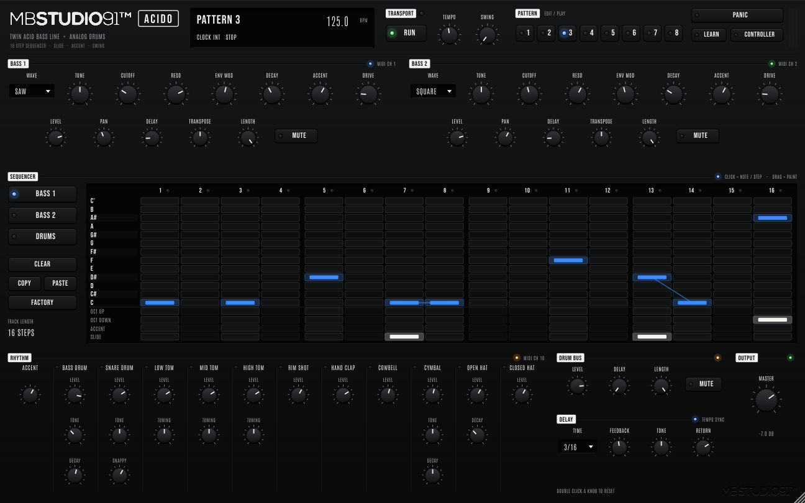

# MBStudio91 acido

Strumento acid in un solo plugin: due linee di basso acide e una drum machine analogica a 11 voci, guidate da un sequencer a 16 passi. Il suono prende come modello il basso Roland TB-303 e la batteria Roland TR-808, ma il motore è scritto da zero e il pannello è nello stile hardware MBStudio91. Formati: VST3, AU (Mac) e Standalone.



## Scaricare

Ogni aggiornamento del ramo `main` viene compilato da GitHub Actions. I file pronti sono nella pagina **Releases** del repository:

- `acido-VST3-mac.zip`, `acido-AU-mac.zip`, `acido-App-mac.zip` (Apple Silicon e Intel, macOS 11 o successivo)
- `acido-VST3-win.zip`, `acido-App-win.zip` (Windows 64 bit)

Il plugin per Mac non è firmato da Apple. Dopo averlo copiato al suo posto, nel Terminale:

```
xattr -dr com.apple.quarantine ~/Library/Audio/Plug-Ins/VST3/"MBStudio91 acido.vst3" ~/Library/Audio/Plug-Ins/Components/"MBStudio91 acido.component" /Applications/"MBStudio91 acido.app"
```

## Cosa c'è

- **BASS 1 e BASS 2**: due voci monofoniche identiche. Oscillatore a dente di sega o quadra con anti-aliasing PolyBLEP, filtro passa-basso a 4 poli con risonanza fino al fischio e saturazione in ingresso, CUTOFF, RESO, ENV MOD e DECAY come sul modello. L'ACCENT alza volume e filtro, accorcia l'inviluppo e carica un condensatore virtuale: più accenti di fila fanno salire il "miagolio". Lo SLIDE lega la nota alla successiva con un glissato di circa 60 ms senza ripartire con l'inviluppo. In più TUNE (+/-12 semitoni), DRIVE, LEVEL, PAN, mandata al DELAY, TRANSPOSE della linea e LENGTH (da 1 a 16 passi, per i poliritmi).
- **RHYTHM**: BASS DRUM (TONE, DECAY), SNARE DRUM (TONE, SNAPPY), LOW, MID e HIGH TOM (TUNING), RIM SHOT, HAND CLAP a raffiche con coda, COWBELL, CYMBAL (TONE, DECAY), OPEN HAT (DECAY) e CLOSED HAT. Piatto, charleston e campanaccio nascono da un banco di 6 oscillatori quadri sempre in corsa, alle frequenze del circuito originale; il charleston chiuso ferma quello aperto. Riga ACCENT con la sua manopola.
- **SEQUENCER**: 8 pattern, ognuno con le due linee di basso e la batteria. Si modifica cliccando nella griglia, trascinando si dipinge una riga. Per i bassi: nota (da C a C'), OCT UP, OCT DOWN, ACCENT, SLIDE. COPY e PASTE copiano un pattern intero, CLEAR svuota la traccia scelta, FACTORY ricarica gli 8 pattern di fabbrica (originali MBStudio91).
- **RANDOM**: genera un pattern nuovo nello stile scelto con RANDOM STYLE. Gli stili sono ACID, TECHNO, FUNK, HIP HOP e R&B. Con AUTO lo stile lo sceglie il generatore, più spesso acid e techno. Per ogni pattern il generatore sceglie una tonica (C, D, E, F, G o A) e una scala adatta allo stile:
  - ACID: pentatonica minore, frigia, eolia, minore armonica, blues
  - TECHNO: pentatonica minore, frigia, eolia, dorica
  - FUNK: dorica, misolidia, pentatonica minore, blues
  - HIP HOP: pentatonica minore, eolia, dorica, blues
  - R&B: dorica, eolia, pentatonica maggiore, pentatonica minore

  Ogni nota resta dentro la scala.

  La batteria parte dai modelli tipici dello stile e cambia ogni volta: cassa in quattro nell'acid e nella techno, cassa sincopata e campanaccio nel funk, cassa spezzata e rullate di charleston nell'hip hop. BASS 1 ripete un motivo di 4 o 8 passi con variazioni; nell'hip hop e nell'R&B segue la cassa con note lunghe e glissati. BASS 2 risponde più in alto sulle note dell'accordo, dove BASS 1 tace.

  RANDOM imposta anche tempo e swing adatti allo stile. Dentro una DAW comanda però il tempo del progetto. RND TRK rigenera solo la traccia scelta e resta nella stessa tonalità. La tonalità del pattern in modifica compare sotto i tasti, alla voce KEY.
- **TRANSPORT**: dentro la DAW segue il tempo e la posizione del progetto. Senza DAW che suona (o nella versione Standalone) usa TEMPO e il tasto RUN. SWING da 50% (dritto) a 75%. Il cambio di pattern durante la riproduzione avviene a fine battuta.
- **DELAY** stereo ping-pong a tempo (da 1/16 a 1/2, compreso 3/16), con FEEDBACK, TONE e RETURN. Ogni traccia ha la sua mandata.
- **MIDI**: canale 2 suona BASS 2, canale 10 la batteria (note GM: 36 cassa, 38 rullante, 39 clap, 42 charleston chiuso, 46 aperto, 49 piatto, 56 campanaccio, tom su 41-50), tutti gli altri canali suonano BASS 1. Velocity sopra 100 vale come accento; sui bassi una nota suonata mentre la precedente è ancora tenuta fa lo slide. Mentre si suona un basso da tastiera, il sequencer di quel basso si fa da parte.
- PANIC (anche CC 120), MIDI LEARN con clic destro su qualsiasi controllo, profili pronti per i controller più diffusi, finestra ridimensionabile.

## Prove fatte su questa versione

- Render offline degli 8 pattern a 48 kHz (`tools/render.cpp`): nessun valore non valido, picchi tra -4 e -7 dBFS, RMS tra -17 e -22 dBFS con il MASTER a -7 dB. Un blocco da 256 campioni usa tra l'1,6 e il 2,9% del tempo disponibile (server Linux, un solo core).
- Clock della DAW simulato a 120 BPM: 32 passi in 4 secondi, come previsto.
- MIDI: nota sul canale 1 e cassa sul canale 10 suonano.
- Generatore: 200 pattern per stile senza nessuna nota fuori scala. Rigenerando una sola traccia la tonalità resta la stessa. Un esempio per stile, fatto suonare e misurato, ha il picco tra -2,7 e -4,9 dBFS.
- Compilazione VST3 e Standalone su Linux senza errori. Il controllo con pluginval (strictness 10) gira su GitHub Actions a ogni aggiornamento.

## Limiti di questa prima versione

- Non è un clone circuitale: filtro, accento e voci della batteria sono modelli scritti a orecchio e su dati pubblici, non misurati su strumenti reali.
- Il sequencer non ha ancora la scrittura in tempo reale (tap write) né le catene di pattern.
- Niente uscite separate per gli strumenti della batteria: tutto esce sulla coppia stereo principale.

## Compilare in proprio

Servono CMake e, su Mac, Xcode (`brew install cmake`).

```
cmake -S . -B build -G Xcode
cmake --build build --config Release --target MBStudio91Acido_VST3 MBStudio91Acido_AU MBStudio91Acido_Standalone
```

JUCE 9.0.5 si scarica da solo. Per usare una copia locale aggiungi `-DJUCE_DIR=/percorso/JUCE`. Lo strumento di prova si attiva con `-DACIDO_BUILD_TOOLS=ON` (target `acido_render`).

## Licenza e marchi

Codice sotto GNU AGPL v3 (vedi `LICENSE.md`), come richiesto dalla licenza libera di JUCE. Font Bebas Neue e Antonio sotto SIL Open Font License (`MBStudioUI/fonts`).

Roland, TB-303 e TR-808 sono marchi di Roland Corporation. acido non è affiliato a Roland né approvato da Roland; i nomi servono solo a dire a quale suono si ispira.
